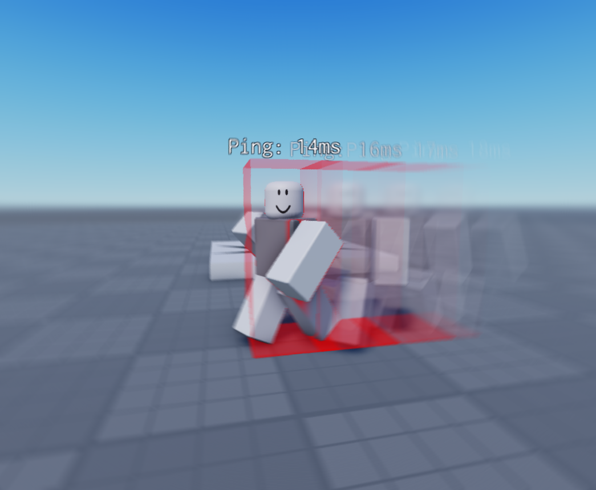

# PlayerReplication by [@exelerantt](https//github.com/exelerantt)

[Repository](https://github.com/exelerantt/PlayerReplication)

[Demo Showcase](https://youtu.be/vq3rieIVbSM)

*Do note that you should convert the parts to MeshParts and use "73706483794360" as your MeshID.*

<!-- markdownlint-disable-next-line MD050 -->
**__Question:__** *What is player replication?*
<!-- markdownlint-disable-next-line MD050 -->
**__Answer:__** Player replication is the little pill you see following behind you, it is the server showing your position, and my task was to make it better and more accurate, which is also known as **Ping Compensation** or **Player Interpolation**.

